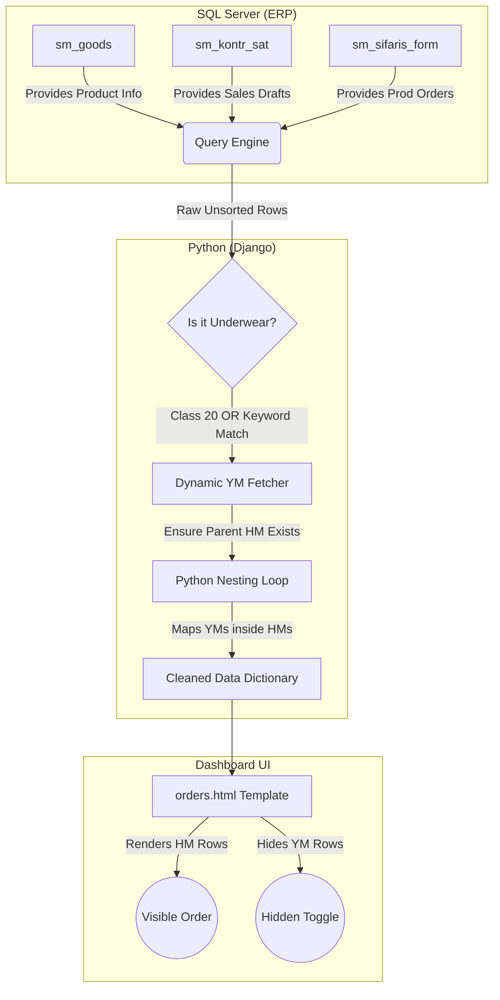
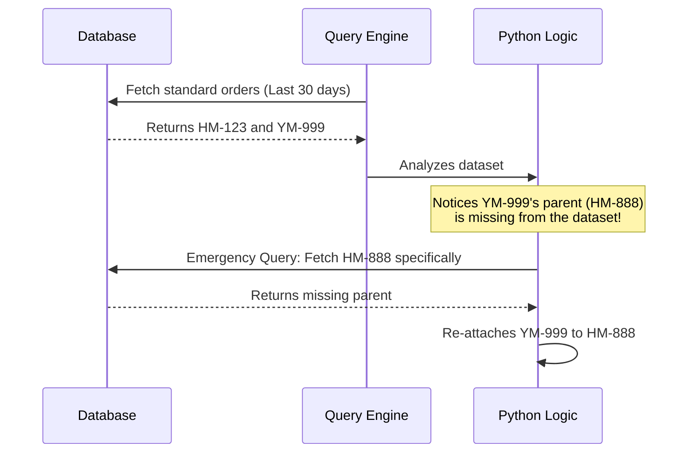

# Underwear Category: System Logic & Architecture Map

This document outlines exactly how the Underwear (Mayka/Boxer) category extracts, filters, processes, and displays data in the ERP Dashboard. It is designed to help developers quickly understand the data flow, database tables, filtering rules, and Python grouping logic.

---

## 1. High-Level Data Flow

The following diagram illustrates how data moves from the raw SQL Server ERP database, passes through the Python backend filtering logic, and is finally nested and rendered in the frontend.



---

## 2. Database Tables Involved

The dashboard relies on a monolithic ERP database structure. There are no separate tables for Underwear; everything is mixed. 

| Table Name | Purpose in Dashboard | Key Columns Used |
| :--- | :--- | :--- |
| **`sm_goods`** (`g`) | Master list of all products. Determines if an item is Underwear. | `idn`, `name`, `class` |
| **`sm_sifaris_form`** | Holds Active Production Orders. | `sifaris` (Parent HM ID), `mehsul` (Product ID) |
| **`sm_kontr_sat`** | Holds Sales Contracts / Drafts (Satış sifarişləri). | `sened`, `tarix`, `mehsul` |
| **`sm_sif_sened`** | Holds Delivery/Shipment documents. | `mehsul`, `miqdar` |

---

## 3. The Extraction Logic (SQL Filtering)

Because the ERP database mixes Workwear, Socks, and Underwear, the system uses a **Hybrid Safety Filter** in `dashboard/queries.py` to pull *only* Underwear products.

### The Hybrid Rule
```sql
g.class = 20 OR (
    (g.name LIKE '%BOXER%' OR g.name LIKE '%MAYKA%' OR g.name LIKE '%KÜLOT%' OR g.name LIKE '%BODY%' OR g.name LIKE '%SLİP%') 
    AND (g.name LIKE 'HM-%' OR g.name LIKE 'YM-%' OR g.name LIKE 'TM-%')
) OR g.idn IN ({dynamic_ym_ids})
```

> [!IMPORTANT]
> **Why this rule exists:**
> 1. **Strict Class Matching:** It pulls 100% of products officially assigned to `Class 20` (Underwear).
> 2. **Keyword Fallback:** Because data entry users historically forgot to assign classes to some underwear items (or accidentally assigned them to Socks `Class 6` or Workwear `Class 18`), the query scans product names for explicit underwear keywords.
> 3. **Prefix Safety:** The keyword match strictly requires an `HM-`, `TM-`, or `YM-` prefix to prevent false positives (like raw materials or machines).

---

## 4. Dynamic Parent Fetching (Orphan YM Prevention)

Yarım Məhsul (YM) components are internal transactions that belong to a parent Hazır Məhsul (HM) order. 

**The Problem:** Sometimes an active YM transaction exists in the factory today, but its parent HM order was created months ago and falls outside the standard dashboard date range.

**The Solution:**

This logic guarantees that a YM is never left floating alone on the dashboard.

---

## 5. Python Nesting Logic (Backend)

Once the raw SQL data is pulled, `queries.py` iterates through the dataset to separate YMs from HMs.

> [!NOTE]
> The database single-source of truth for parent-child linking is the `sifaris` column inside `sm_sifaris_form`.

1. **Separation:** It loops through `company['orders']` and creates two lists: `all_hms` and `all_yms` (based on `.startswith('YM')`).
2. **Linking:** It creates a dictionary `hm_by_order` mapped by the parent order ID.
3. **Nesting:** It loops through `all_yms`. Using the YM's `parent_order_id`, it finds the correct parent HM, and appends the YM data directly into `target_hm['yms']`.
4. **Purging:** All YMs are permanently deleted from the top-level array.

---

## 6. Frontend Rendering (UI)

The UI template (`orders.html`) receives a clean array containing *only* parent HM orders.

```html
<!-- Simplified Logic -->

    <!-- 1. Render Top Level HM Row -->
    <tr class="hm-row">
        <td>{{ order.cesid }}</td> <!-- e.g. HM-BETEX BOXER -->
    </tr>

    <!-- 2. Check for Hidden YMs -->
    
        <tr class="toggle-row" onclick="toggleYMs('{{ order.order_id }}')">
            <td>⬇ {{ order.yms|length }} yarım fabrikat komponentini göstər</td>
        </tr>
        
        <!-- 3. Hidden YM Rows -->
        
            <tr class="ym-row hidden" id="ym-{{ order.order_id }}">
                <td>↳ {{ ym.cesid }}</td>
            </tr>
        
    

```

> [!TIP]
> **JavaScript Animation:** The expansion is handled cleanly via Vanilla JavaScript by toggling the `hidden` class, providing a smooth accordion effect without making extra calls to the backend.
